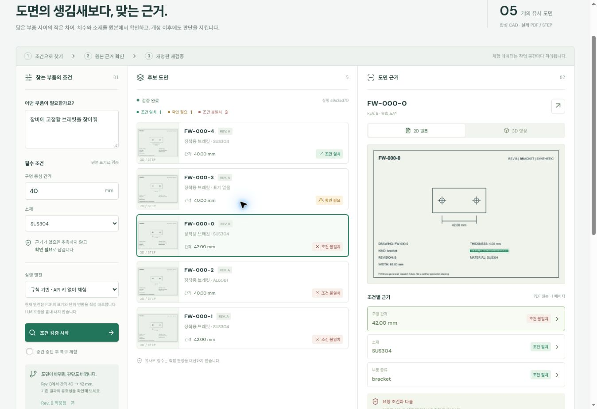
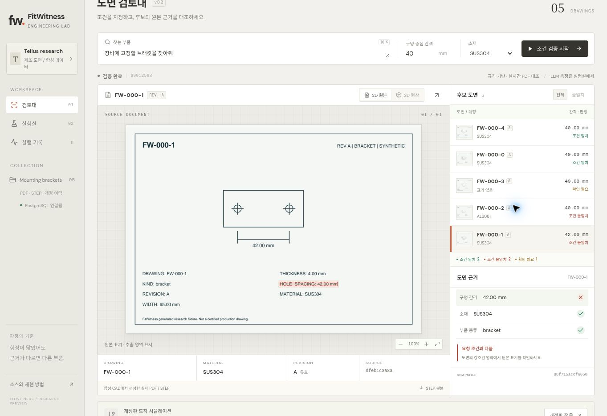
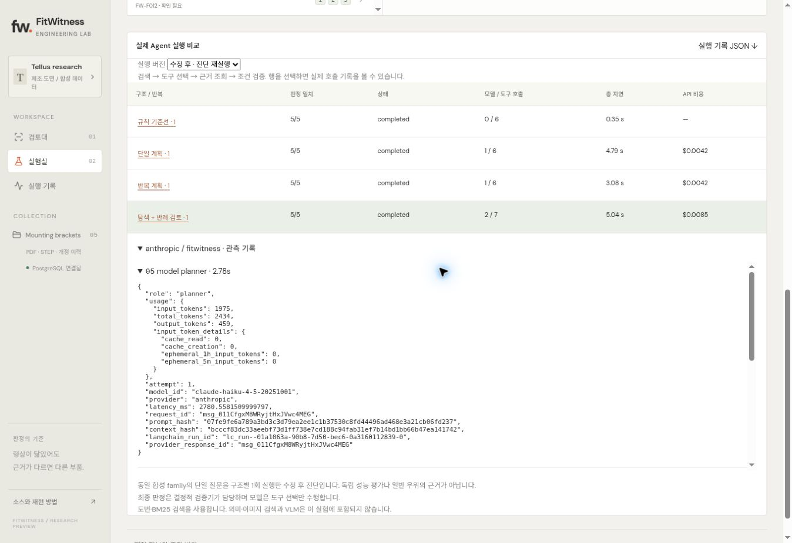
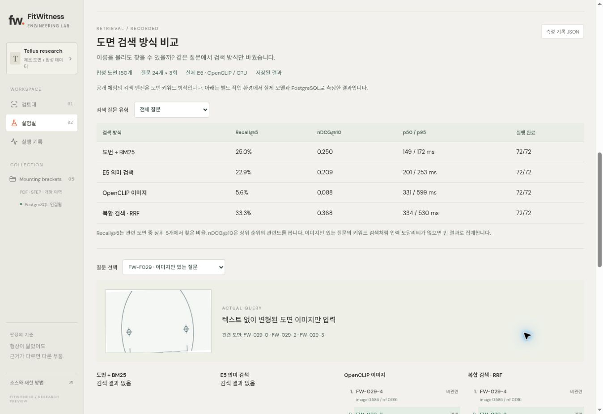

# 배포와 검증 상태

- 데모: https://fitwitness.onrender.com/
- 저장소: https://github.com/sokldjs554/fitwitness
- 배포 브랜치: `main` (`render.yaml`, 자동 배포 꺼짐, Render 대시보드에서 수동 배포)
- 처음 배포한 `feat/fitwitness-foundation`은 PR [#1](https://github.com/sokldjs554/fitwitness/pull/1)로 2026-10-05에 main에 병합했습니다
- 공개 데모가 돌리는 코드: `88a7484`(2026-10-29 12:12 UTC 확인; 그 전은 93a794c·fcd746d·45ccf9a). 스캔 읽기 예시(`#claims-scan`)에 더해 서류 **보완 요청** 결정과 "원장에 지급 기록" 문구가 들어 있습니다. `/health`의 sha가 이 커밋과 같고(저장소의 main과도 같음), `scripts/verify_hosted.py`가 01:03 UTC에 전체 통과했습니다([기록](verification/hosted-20261029-93a794c.json)). 직전 배포 `02bd3df`의 기록은 [여기](verification/hosted-20261028-02bd3df.json), 그 앞은 `f925d1b`([기록](verification/hosted-20261028-f925d1b.json)). 배포 절차는 [아래](#2026-10-26-배포)
- 깨워 두기: 무료 인스턴스는 15분 동안 요청이 없으면 잠들고, 그 뒤 첫 화면은 89.5초 걸렸습니다(2026-10-27). [아래](#깨워-두기-2026-10-27)


바깥 연결 없이 돌리는 범위와 켜는 순서는 [ONPREM.md](ONPREM.md)에 따로 적었습니다.
## 실제 구성

2026-10-04 사용자가 승인한 무료 구성입니다. Render `My workspace`의 Singapore 무료 Python 웹 서비스와 Neon Free의 Singapore PostgreSQL 16 전용 `fitwitness` 프로젝트를 연결했습니다. 기존 프로젝트와 데이터베이스는 변경하지 않았습니다. 유료 리소스와 유료 모델 호출은 활성화하지 않았습니다.

Render 기본 무료 DB는 계정의 기존 무료 DB 때문에 생성할 수 없었습니다. 외부 무료 DB를 사용하라는 지시에 따라 Neon을 연결했습니다. Render 연결 도구가 Docker 서비스 생성을 지원하지 않아 네이티브 Python 런타임을 사용합니다. `render.yaml`에 실제 빌드·실행 명령을 기록했으며, Dockerfile은 별도의 실행 경로입니다.

빌드는 uv 고정 의존성 설치, CadQuery 합성 도면 180개와 합성 청구 120건 생성, React 프런트엔드 빌드를 수행합니다. 시작 시 `scripts/setup.py`가 스키마·pgvector·RLS·체크포인트를 준비하고 uvicorn을 실행합니다.

## 연결과 비밀 정보

- `FITWITNESS_DATABASE_URL`: Neon **direct** TLS 연결. worker가 세션 advisory lock을 사용하므로 transaction pooler URL로 바꾸지 않습니다.
- `FITWITNESS_SESSION_SECRET`, `FITWITNESS_METRICS_TOKEN`: Render 환경 변수에만 저장합니다.
- `FITWITNESS_ALLOWED_ORIGINS`: `https://fitwitness.onrender.com`.
- PostgreSQL 16 관리 계정은 역할의 ADMIN 권한이 있어도 SET 권한이 없을 수 있습니다. 마이그레이션이 `GRANT fitwitness_app TO CURRENT_USER WITH SET TRUE`를 명시합니다. 요청은 여전히 NOLOGIN/NOBYPASSRLS 역할 및 FORCE RLS로 격리합니다.
- 실제 API로 생성한 서비스의 Render health-check 경로는 기본값입니다. `/ready`는 DB 역할과 쿼리까지 확인하며, Blueprint에는 `/ready`를 지정했습니다.

## 배포 검증

수정 전 CI [37183283373](https://github.com/sokldjs554/fitwitness/actions/runs/37183283373)에서 새 managed-role 테스트가 실제 `permission denied to set role` 오류를 재현했습니다 (기존 66개 통과). 수정 후 `c1508f2`의 CI [37183531736](https://github.com/sokldjs554/fitwitness/actions/runs/37183531736)은 독립 DB 환경 2회에서 각각 Python 67개, 데스크톱·모바일 E2E 4개, 시연 캡처 및 종료 정리까지 전체 성공했습니다. 같은 커밋을 배포한 공개 HTTPS 서비스에서 `scripts/verify_hosted.py`가 2026-10-04 06:49 UTC에 전체 통과했습니다. [검증 결과 JSON](verification/hosted-20261004.json).

공개 서비스 검증 명령은 DB 비밀 정보가 필요하지 않습니다.

```bash
python scripts/verify_hosted.py --url https://fitwitness.onrender.com
```

이 스크립트는 readiness, HTTPS 쿠키, PDF/STEP/mesh, 중복 요청 방지, 실제 worker 중단 복구, 개정판 무효화·재검증, 세션 격리, Origin 차단, metrics 보호, 유료 모델 거부를 확인합니다. 결과는 `artifacts/hosted-verification.json`에 저장합니다.

공개 브라우저에서도 도면 5개 로딩, 중단 후 checkpoint 복구, 원본 PDF 근거, 개정 시 `재검증 필요`, 재실행 후 판정 변화를 확인했습니다.

| 판정 | 개정 전 | 개정 후 |
| --- | ---: | ---: |
| 조건 일치 | 2 | 1 |
| 조건 불일치 | 2 | 3 |
| 확인 필요 | 1 | 1 |

검증 브라우저는 WebGL을 제공하지 않아 3D 탭의 STEP 다운로드 대체 안내를 확인했습니다. 공개 mesh 및 STEP 전송은 정상이며, 이 브라우저에서 3D 렌더링 성공으로 보고하지 않습니다.



## 무료 체험의 범위

- Render 무료 서비스는 유휴 상태 후 재기동 시간이 발생할 수 있습니다. 처음 열 때 로딩을 기다려 주세요.
- 활성 서버의 dispatcher는 PostgreSQL을 주기적으로 조회하므로 Neon 컴퓨트 사용량을 소모합니다. 무제한 상시 운영을 보장하지 않습니다.
- 공개 데모는 규칙 기반 엔진입니다. OpenAI·Claude 어댑터가 있어도 익명 API에서 유료 모델은 실행하지 않습니다.
- 데이터는 직접 생성한 합성 CAD입니다. 실제 산업 도면 성능, 일반 스캔 OCR, VLM 검증 완료를 주장하지 않습니다. 저장된 Qwen·Claude 실측의 범위는 아래 평가 기록에 한정됩니다.

공식 참고: [Neon 역할](https://neon.com/docs/manage/roles) · [연결 풀링](https://neon.com/docs/connect/connection-pooling) · [Neon Free](https://neon.com/docs/introduction/free-tier) · [Render Free](https://render.com/docs/free) · [PostgreSQL 16 GRANT](https://www.postgresql.org/docs/16/sql-grant.html)

## v0.2 — 도면 작업대와 실측 LLM 실험실

2026-10-04 `743026f42666dbbcfa1da7f7ac9e58d2728aeedf`를 배포했습니다. Render 배포 `dep-db109qad0e5s73dggctg`는 live 상태이며, 공개 `/ready`가 DB 연결을 확인합니다. `/api/evaluations`의 전체 JSON은 저장소의 측정 기록과 일치합니다. [검증 결과](verification/ui-eval-20261004.json).

[CI37186711069](https://github.com/sokldjs554/fitwitness/actions/runs/37186711069)에서 독립 PostgreSQL 환경 두 개 모두 Python76개, 데스크톱·모바일 E2E6개, 실제 API 기반 시연 캡처가 통과했습니다. 작업대의 후보 필터, 도면 근거, 개정판 재검증, worker 복구, 실험실 이동과 Ctrl/Cmd+K를 확인합니다.

실험실은 Qwen3-1.7B 실제 추론72회의 저장된 결과를 제공합니다. 정확도 75%, 잘못된 일치 28.6%(정답이 불일치·확인 필요인 42회 중 12회), 지연 p50 6.18초입니다. 24개 사례·4개 family의 PDF 근거 판정 pilot이며 전체 Agent·검색·VLM 또는 OpenAI·Claude 평가가 아닙니다. 모델 가중치와 추론 라이브러리는 Render 서비스에 배포하지 않으며 무료 웹서버에서 LLM 추론을 실행하지 않습니다.


[모바일 화면](media/evaluation-mobile.png) · [평가 설계와 원시 기록](evaluation/README.md)

공개 브라우저에서도 실험실24개 사례와 오류6개 필터, 반복2출력 전환, 작업대 실제검증 완료, 불일치후보2개 필터 및42mm PDF근거 표시를 확인했습니다.



## Claude 평가 공개 갱신 — 2026-10-04

Render 배포 `dep-db11qbtg1s2s7385mt80`, 코드 `f6a7f82d53e7da0f3dbe27f0d4eeaabd63432426`가 live입니다. CI `37192269005`의 독립 DB 두 환경 각각 Python98개·E2E8개, 컨테이너 `37192269007`이 통과했습니다. 공개 서버에서도 복구 exactly-one completion, 개정2/2/1→1/3/1, 세션 격리·origin·유료 API 차단을 다시 검증했습니다. [실서버 기록](verification/hosted-agents-20261004.json).

브라우저에서 Claude72/72와 v1 실패3개를 확인했습니다. 후속 데이터 게시 정정은 v2 진단의 반복 횟수 설명만 바꾸며 코드·점수·원본 기록은 동일합니다. 공개 사이트에는 비밀 키를 전달하지 않았고 유료 호출은 CI 운영자 실험에만 사용했습니다.

최종 게시 정정본 `2d9fda933a9d666027cf98a5dd1e38c8f117f5a2`의 배포 `dep-db11tffavr4c739sc4k0`는 2026-10-04 09:41:45 UTC에 live가 됐습니다. 공개 health SHA·readiness와 Claude/v1/v2 평가 JSON의 저장소 일치를 확인했습니다. 앱 코드는 위 CI 통과본과 동일합니다.

공개 브라우저에서 수정 후 진단의 세 구조 모두 완료·각5/5, 구조별1회라는 제한 안내, 실제 Anthropic 응답 ID와 토큰·지연 기록을 확인했습니다. 개선 전 실패 기록은 버전 선택으로 계속 열람할 수 있습니다. 전체 API 계산 비용은 $0.187841이며 미확정 예약액은0입니다.



## 의미·이미지 검색 실측 공개 — 2026-10-04

Render 배포 `dep-db13nve0tbcc739c69t0`, 코드 `8a1d8b065399bff657bde1db4a25e9a7636cc0cb`가 11:46:25 UTC에 live가 됐습니다. 앱 코드는 검증한 `431d6998d41cd3993e73b530a04be03be0d3d37a`와 같고, 이후 변경은 원본 보존 workflow입니다. CI `37199419442`의 독립 DB 두 환경 각각 Python 116개·데스크톱/모바일 E2E 10개, 컨테이너 `37199419433`이 통과했습니다.

공개 `/api/evaluations/retrieval` 전체 JSON과 저장소 보고서가 일치합니다. 브라우저에서 전체/이미지 질문 필터, 실제 변형 질문 이미지, 상위 후보의 관련도와 채널 점수를 확인했습니다. 실시간 공개 체험은 도번·키워드 검색이며, E5·OpenCLIP 검색은 별도 환경에서 수행한 288회 실측 기록입니다. 원본 PDF·PNG 300개의 동결 해시를 대조한 [자료 묶음](evaluation/retrieval-37198685994/sources.zip.xz)도 보존했습니다. 추가 유료 LLM 호출은 0회입니다.

[검색 프로토콜·결과·한계](RETRIEVAL.md) · [배포 검증 기록](verification/hosted-retrieval-20261004.json)



## 2026-10-05 연구 결과 배포

앱 SHA `e2a1dbd921aa5cb214cf9a583415d60b71db8fb0`, Render deploy `dep-db1ma0dg1s2s73as94gg`가 live입니다. 두 PostgreSQL 환경 각각140Python+12E2E, 컨테이너 검증 후 배포했습니다. 공개 보고서 JSON은 검산한 재정렬/VLM 파일과 일치합니다. [공개 HTTPS 검증](verification/hosted-research-20261005.json)은 worker 복구·단일 완료·개정판 무효화/재검증·tenant·origin·유료API·metrics 경계를 통과했습니다. 배포 이후 확인 구간의 app error 로그는0건이었습니다.

공개 무료 환경은 lexical/rules 체험과 저장된 연구 결과를 제공합니다. E5/OpenCLIP/BGE와 Claude VLM은 격리된 연구 환경에서 실행했습니다. 새 영상·캡처·문서만 추가한 후속 커밋은 재배포하지 않습니다.

## 깨워 두기 (2026-10-27)

무료 Render 인스턴스는 15분 동안 요청이 없으면 잠듭니다. 2026-10-27에 18분 동안 아무 요청도 보내지 않은 뒤 첫 화면을 여니 89.5초가 걸렸고, 바로 다음 요청은 1.3초였습니다. 면접관이 링크를 처음 여는 순간이 바로 이 경우라 두 겹으로 깨워 둡니다.

- `.github/workflows/uptime.yml`: 10분마다(:04, :14, …) `/health`를 GET합니다. 응답 코드·시간·배포 sha를 실행 요약에 남기고, 20초가 넘으면 잠들어 있던 것으로 보고 `woken`으로 적습니다. 200이 아니면 실행이 실패하고 GitHub가 메일로 알립니다. GitHub의 예약 실행은 늦게 시작할 때가 있어 이것만으로는 15분을 못 지킬 수 있습니다. 실제로 첫 열 시간(2026-10-27 15시~10-28 01시 UTC)에 예약 실행은 두 번(20:01, 23:43)뿐이었고, 두 번 모두 잠든 데모를 깨웠습니다(`/health`까지 32.7초, 36.0초). 깨워 두는 데는 외부 모니터가 필요하고, 이 workflow는 깨어나는 데 걸린 시간을 남기는 기록으로 남습니다.
- 외부 모니터(지원자 계정): UptimeRobot이나 cron-job.org 같은 무료 서비스에 `https://fitwitness.onrender.com/health`를 5분 간격으로 등록합니다. `/health`는 DB를 건드리지 않아 Neon 컴퓨트를 깨우지 않습니다. DB를 조회하는 `/ready`는 모니터에 쓰지 않습니다. HEAD로 확인하는 모니터를 위해 `/health`가 HEAD에도 200을 주게 했습니다(다음 배포부터).
- Render 무료 플랜은 워크스페이스당 한 달 750 인스턴스 시간입니다. 이 서비스 하나를 계속 깨워 두면 최대 744시간이라 다른 무료 서비스를 함께 돌릴 여유는 없습니다. 배포 직후의 첫 기동은 깨워 두기와 상관없이 기다려야 합니다.

**89.5초 중 앱의 몫 (2026-10-27, 로컬 측정).** 시작 명령이 하는 일을 이 개발 기계(4코어)에서 CPU 시간으로 쟀습니다.

- `scripts/setup.py`(이미 만든 스키마 확인과 checkpoint 표): 0.66초
- uvicorn이 앱을 올리고 `/health`에 답할 때까지: 1.36초(그중 import가 0.87초: FastAPI·pydantic, 계약 모델, psycopg, pdfplumber, BM25)
- 그 뒤 20초 동안: 데모 도면 20장의 사실을 미리 뽑는 스레드 0.7초, 실행용 worker 한 개를 미리 띄우는 데 2.15초

첫 응답 전에 앱이 쓰는 CPU는 2초 남짓입니다. Render 무료 인스턴스의 CPU 몫이 작다는 것을 감안해도 89.5초의 대부분은 플랫폼이 인스턴스를 다시 올리는 시간으로 봅니다. 다만 Render에서 단계별로 잰 값은 아닙니다. import를 늦추거나 checkpoint 확인을 건너뛰어 줄일 수 있는 것은 0.3~0.5초로, 깨워 두기에 비하면 작아 코드는 바꾸지 않았습니다. 실제로 잠들었다 깬 경우는 `uptime` 실행 요약에 `woken`과 걸린 초로 쌓입니다.

## 2026-10-26 배포

첫 배포의 `/health`는 `1f4b06faac9cfded913cac71cde650f5c17ac21f`였습니다. 10-08 배포(`0e60d3c`) 뒤 바뀐 앱 코드, 곧 사용자 테스트 뒤 화면 네 곳(`3922482`), `search_shell`(`49ff361`), 스캔 서식 격자 읽기, 표제란 읽기 규칙, 플래너 문맥의 `retrieval`, 실패한 계획의 한 번 더 기회, 지표 누계 표 `fw_metric_totals`, 요청 미들웨어의 500 집계, 디스패처 수정([LOAD.md](LOAD.md))이 모두 들어갔습니다. 새 표 `fw_metric_totals`는 시작 명령의 `scripts/setup.py`가 `CREATE TABLE IF NOT EXISTS`로 만들고, 배포 뒤 `/ready`가 통과합니다.

[공개 HTTPS 검증](verification/hosted-20261026.json)은 2026-10-26 09:28 UTC에 전체 통과했습니다. 도면이 20장으로 늘어 검사 스크립트가 문서 수를 세션 응답에서 읽도록 고쳤고, 판정 개수는 같은 커밋을 띄운 로컬 서버에서 먼저 확인했습니다(`--local`). 통과한 항목은 health·ready, 401, Secure 쿠키, 20장 전부의 PDF/PNG/STEP/메시 자산과 정확한 ID 검색, 멱등 키, worker 중단 뒤 재개와 단일 완료, 개정판 무효화와 재검증(일치 2·불일치 3·미확인 1 → 1·4·1), origin 403, 유료 모델 409, 세션 격리입니다. 브라우저(Chromium)로 두 화면을 열어 사용자 테스트 뒤 바꾼 문구가 실제 번들에 있고 콘솔 오류가 없는 것도 확인했습니다.

**같은 날 두 번째 배포: 도면 위치.** 같은 브라우저 확인에서 1440×1000 화면의 도면이 y=1128에 그려져 첫 화면 밖에 있었습니다. 후보 목록(20장)과 같은 높이로 늘어난 칸의 세로 가운데에 도면을 놓았기 때문입니다. `web/src/style.css`의 `.drawing-stage`를 위쪽 정렬로 바꿔(`adec980`, 로컬 E2E 70개 통과) 다시 배포했습니다. 공개 데모에서 도면이 y=575로 첫 화면 안에 들어왔고 콘솔 오류는 없었습니다. 모바일 폭(390×844)에서는 화면이 한 줄로 쌓여 도면이 검색 칸 아래(y≈906)에서 시작합니다. 앱 코드는 이 CSS 한 줄만 바뀌었지만 [공개 HTTPS 검증](verification/hosted-20261026-adec980.json)을 15:15 UTC에 다시 돌려 같은 항목이 모두 통과했습니다.

**방문자 주소: 위험 아님 (2026-10-26 확인).** 체험 공간은 시간당 100개, 주소당 20개까지 만듭니다(`/api/demo-sessions`). 주소는 `request.client.host`이고, 이 확인 때까지는 SHA-256 앞 16자리로 바꿔 저장했습니다. uvicorn 기본값은 127.0.0.1에서 온 `X-Forwarded-For`만 믿어서, Render 프록시 뒤에서는 모든 방문자가 프록시 주소 하나로 세어질 수 있다고 봤습니다. 지원자가 Neon에서 `fw_admission`의 최근 20줄을 뽑아 확인했는데, 그렇지 않았습니다. 시간대 여섯 개의 주소 수는 10-08 04시 7개, 10-26 09시 5개, 15시 4개, 10-23 16시 2개, 10-11 11시와 10-23 17시 1개였습니다(UTC). 그중 16줄은 공개 서버를 검사한 클라우드 컨테이너들의 공개 주소의 해시와 정확히 같았습니다. 그 주소는 데모 도메인의 `/cdn-cgi/trace`가 돌려준 주소로, 한 대역 안에서 연결마다 바뀝니다. 나머지 4줄은 그 대역 밖의 방문자이고, 10-23 16시에는 그런 방문자 둘이 서로 다른 주소로 세어졌습니다. 서버는 Cloudflare가 본 방문자의 공개 주소를 세고 있고, 주소당 한도는 방문자마다 따로 걸립니다.

남은 것이 둘 있었습니다. 하나는 위험이 낮아 고치지 않았습니다. uvicorn이 어떤 설정으로 그 주소를 받는지 모른다는 것입니다. Render가 `FORWARDED_ALLOW_IPS`를 주는지는 문서에서 찾지 못했습니다. `X-Forwarded-For`의 맨 앞 값을 믿는 설정이라면 방문자가 그 값을 꾸며 주소당 한도를 피할 수 있습니다. 그래도 시간당 100개 전체 한도는 그대로입니다. 다른 하나는 고쳤습니다. 저장하던 값이 키 없는 SHA-256이라 IPv4 주소를 모두 대입하면 원래 주소로 되돌릴 수 있었고, 이 확인에서도 검사한 컨테이너의 대역만 그렇게 대입했습니다. 이제는 세션 서명 비밀키(`FITWITNESS_SESSION_SECRET`)에서 용도별로 따로 만든 키로 HMAC-SHA256을 씁니다. 새 환경 변수는 없습니다. 2026-10-27에 `908e733`으로 배포했고, 배포한 그 시간에는 주소별 개수가 새로 시작했습니다. 배포 뒤 [공개 HTTPS 검증](verification/hosted-20261027-908e733.json)이 08:55 UTC에 다시 전체 통과했습니다. 그 검증이 만든 두 줄(`sessions:498080:…`, 같은 클라우드 대역 160.79.106.x에서 접속)은 160.79.0.0/16 전체를 키 없는 SHA-256으로 대입해도 하나도 맞지 않았습니다. 같은 방법으로 배포 전 줄은 16줄이 모두 맞았습니다.

## 2026-10-28 두 번째 배포: 스캔 읽기 예시

지원자가 Render 대시보드에서 `main`(`02bd3df`)을 수동 배포했습니다(자동 배포는 꺼져 있고 저는 Render에 접근할 수 없어 대신 올릴 수 없습니다). 배포 뒤 세 가지를 확인했습니다.

- `/health`의 sha가 `02bd3df13f430737eb73f6067205df7cb32387d8`이고 첫 응답이 1.4초였습니다(서버가 깨어 있었습니다).
- 공개 서버의 `/api/evaluations/scan-examples`가 저장소의 `docs/evaluation/scan-examples.json`과 같고, 다섯 장의 그림(`plain`·`second-read`·`repaired`·`unread`·`scan-denial`)이 저장소 파일과 sha256이 같습니다. 허용 목록 밖 이름(`x.png`, `scan-examples.json`, `..jpg`)은 404입니다.
- 브라우저로 `https://fitwitness.onrender.com/#claims-scan`을 데스크톱(1440×1000)과 모바일(390×844)에서 열어, 이 주소가 청구 탭을 열고 예시 구역으로 스크롤되는 것, 예시를 바꾸면 결과가 바뀌는 것(확대 재읽기 예시는 지급 530,000원, 못 읽은 값 예시는 담당자 확인), 옆으로 넘치지 않는 것을 확인했습니다. 이 샌드박스의 브라우저는 프록시 CA를 신뢰 저장소에 갖고 있지 않아, 그 CA의 공개키 하나만 허용하는 옵션으로 열었습니다(TLS 검증을 끈 것은 아닙니다).
- `scripts/verify_hosted.py`는 이번에 예시 기록과 그림 서빙 검사를 더해 전체 통과했습니다. 기록은 [hosted-20261028-02bd3df.json](verification/hosted-20261028-02bd3df.json)입니다.

화면의 예시는 미리 계산한 기록입니다. 공개 서버에는 글자 인식 엔진이 없어서 요청 때 아무것도 읽지 않습니다.

## 2026-10-29 세 번째 배포: 서류 보완 요청

지원자가 Render 대시보드에서 `main`(`93a794c`)을 수동 배포했습니다. 이 커밋은 보험 현업자 테스트 뒤의 변경(`cee0832`: 보완 요청 결정, "원장에 지급 기록" 문구, 담당자 이름 안내)과 기록 문서를 포함하고, 앱 코드는 `cee0832`와 같습니다. 배포 뒤 확인한 것:

- `/health`의 sha가 `93a794caf9d6a1cf217b2f0b5d1e15bf68f2fa78`이고 응답이 0.7초였습니다.
- `scripts/verify_hosted.py`에 검사를 하나 더했습니다. 서류 누락 건을 돌려 담당자 확인에 멈추게 한 뒤, 메모가 빈 보완 요청은 422로 거절되는지, 메모가 있는 보완 요청은 결정 `REVIEW`·0원·사유 `R-HUMAN-02`·지급 `skipped`로 끝나는지, 지급 원장이 그대로인지 확인합니다. 로컬 서버(새 DB)에서 먼저 통과한 뒤 공개 서버에서 통과했고, 스캔 예시 다섯 장 서빙 검사도 함께 통과했습니다. 기록은 [hosted-20261029-93a794c.json](verification/hosted-20261029-93a794c.json)입니다.
- 브라우저로 공개 주소를 데스크톱(1440×1100)과 모바일(390×844)에서 열어 실제로 눌러 보았습니다. 서류 누락 건에서 담당자 확인 패널에 "계정 인증은 하지 않습니다" 안내가 보이고, "보완 요청"은 메모가 비면 눌리지 않고 메모를 적으면 눌렸으며, 누르면 "심사 보류 · 보완 요청 / 지급 없음"으로 끝나고 지급 원장 숫자가 그대로였습니다. 정상 청구는 "원장에 지급 기록 … · 송금은 이 시스템 밖"으로 표시됐습니다(지급 210,000원).

이 확인은 공개 데모의 체험 공간 두 개를 더 썼습니다(검증 스크립트 한 개, 브라우저 둘). 체험 공간은 방문자마다 따로 만들어지고 시간당 한도 안입니다.


## 원클릭 배포 (`deploy.yml`, 2026-10-29)

Render의 자동 배포는 꺼 둔 채(`render.yaml`), Actions 탭에서 한 번 눌러 배포하는 워크플로를 더했습니다. 배포할 커밋(기본은 main의 머리)에 CI(`verified-demo`)가 통과했는지 확인하고, 그 커밋을 배포 훅으로 배포한 뒤, 공개 서버의 `/health`가 그 커밋을 보고할 때까지 기다리고, `scripts/verify_hosted.py`로 공개 HTTPS 검증을 돌려 결과 JSON을 아티팩트로 남깁니다. 이전 커밋을 `ref`로 주면 되돌리기입니다.

필요한 것은 저장소 시크릿 `RENDER_DEPLOY_HOOK_URL`(Render 서비스의 Settings > Deploy Hook) 하나입니다. 없으면 첫 단계에서 멈추고 이유를 적습니다. 이 저장소에서는 아직 등록하지 않았고 한 번도 돌려 보지 않았습니다. 워크플로가 있다는 것이 배포가 자동화됐다는 뜻은 아닙니다.

## 2026-10-29 네 번째 배포: 서류 재접수와 보안 수정

지원자가 `main`(`fcd746d`)을 수동 배포했습니다. 서류 재접수(`/api/runs/{id}/supplement`), 판단하지 못한 담보 옆의 부지급을 담당자에게 보내는 규칙(R-UNDEC-01), 보안 점검의 수정([SECURITY.md](SECURITY.md)), 평가 게이트와 CI 보강이 들어 있습니다. 배포 뒤 확인한 것:

- `/health`의 sha가 `fcd746d13aa006b8df5988b48cde51f675f7bc6f`였습니다.
- `scripts/verify_hosted.py`가 공개 서버에서 통과했습니다(`status: passed`, 검사 14개). 서류 누락 건을 보류한 뒤 대기 서류를 접수하면 같은 청구가 이어져 지급되고, 원장에는 한 줄만 남는지까지 확인합니다. 기록은 [hosted-20261029-fcd746d.json](verification/hosted-20261029-fcd746d.json)입니다.
- 이 확인은 체험 공간을 하나 썼습니다. 브라우저로 화면을 다시 눌러 보지는 않았습니다.

## 2026-10-29 다섯 번째 배포: 검색 상태 재사용, 청구 보강, 라이브 경로(꺼짐)

지원자가 `main`(`45ccf9a`)을 수동 배포했습니다. 시작 때 `migrate()`가 새 DB 개체(`fw_corpus_version`, 개정판·사실·벡터 표의 트리거, `fw_live_spend`)를 호스팅 데이터베이스에 만들었고, 그 위에서 아래가 확인됐습니다.

- `/health`의 sha가 `45ccf9a223b137d7b62e7d5f368fb095e22da286`입니다. `/api/capabilities`의 `live`는 `{"enabled": false}`로, 라이브 모델 읽기는 꺼진 채입니다.
- `scripts/verify_hosted.py`가 공개 서버에서 15개 항목 모두 통과했습니다. 새로 더한 항목은 보류된 청구가 청구인 안내문(접수 기한 포함)을 갖고 담당자 답변의 서명이 `valid`로 확인되는 것입니다. 도면 20장의 PDF·PNG·STEP·메시 해시와 정확한 도번 검색, 작업 복구, 개정판 무효화, 서류 재접수도 같은 실행에서 통과했습니다. 기록은 [hosted-20261029-45ccf9a.json](verification/hosted-20261029-45ccf9a.json)입니다.
- 브라우저(Chromium 데스크톱·모바일 화면)로 공개 주소에서 "담당자가 서류 보완을 요청하면 지급도 거절도 없이 보류" 시나리오를 한 번씩 돌렸고 둘 다 통과했습니다. 청구인 안내문("실제로 보내지 않습니다"), 접수 기한 문구, 담당자 답변 서명 확인이 화면에 나오는 것을 포함합니다. 이 환경의 프록시 인증서는 그 인증서의 공개키 지문 하나만 신뢰하도록 지정해 열었고, 인증서 검증을 끄지 않았습니다.
- 같은 커밋의 GitHub Actions(`verified-demo`)가 성공으로 끝났습니다.
- 이 확인은 체험 공간을 셋 썼습니다(검증 스크립트 하나, 브라우저 둘).
- 하지 않은 것: 공개 서버에서 이어진 입원과 수술분류표 규칙은 화면으로 재현하지 않았습니다(합성 청구 건에 같은 계약의 입원이 둘 있는 경우가 없습니다). 이 규칙들은 단위 테스트가 근거입니다. 라이브 모델 읽기는 켜지 않았습니다.

## 2026-10-29 여섯 번째 배포: 벡터 색인, 담당자 신원(꺼짐), 코드 버전 기록

지원자가 `main`(`88a7484`)을 수동 배포했습니다. 시작 때 `migrate()`가 `fw_vectors`의 채널별 HNSW 색인 셋과 `fw_runs.code_version` 열을 호스팅 데이터베이스에 만들었습니다(공개 데모에는 인코더가 없어 색인은 비어 있습니다).

- `/health`의 sha가 `88a748471869aab56647068bb5eb4200c2e9d2b4`입니다. OIDC 변수가 없으므로 담당자 신원은 익명 그대로이고, 라이브 모델 읽기도 꺼진 채입니다.
- `scripts/verify_hosted.py`가 공개 서버에서 15개 항목 모두 통과했습니다(12:12 UTC). 기록은 [hosted-20261029-88a7484.json](verification/hosted-20261029-88a7484.json)입니다.
- 같은 커밋의 GitHub Actions(`verified-demo`, `container-evaluation`)가 성공으로 끝났습니다.
- 이 확인은 체험 공간을 하나 썼고, 브라우저로 화면을 다시 눌러 보지는 않았습니다(화면이 바뀐 커밋이 아닙니다).

## 라이브 모델 읽기 켜기 (선택, 기본은 꺼짐)

공개 데모의 청구 심사는 규칙으로 읽습니다. 서버에서 아래를 모두 설정해야만 방문자가 모델 읽기 경로(추출기, 같은 근거 검사)를 실제로 돌려 볼 수 있고, 하나라도 없으면 `/api/capabilities`의 `live.enabled`가 `false`이고 요청은 409입니다. 이 저장소의 어느 파일에도 키는 없고, 켜는 것은 운영자의 결정입니다.

| 환경 변수 | 뜻 |
|---|---|
| `FITWITNESS_LIVE_DEMO=on` | 켬 (정확히 `on`만) |
| `ANTHROPIC_API_KEY` | 운영자의 키. Render 환경 변수로만 넣습니다 |
| `FITWITNESS_ANTHROPIC_MODEL` | 쓸 모델 이름 |
| `FITWITNESS_ANTHROPIC_INPUT_USD_PER_MILLION`, `..._OUTPUT_USD_PER_MILLION` | 가격표. 호출 전에 최악의 비용을 계산하는 데 씁니다 |
| `FITWITNESS_LIVE_RUN_USD` | 실행 한 건의 비용 상한. 실행의 예산이 이 값을 넘는 호출을 호출 전에 거절합니다 |
| `FITWITNESS_LIVE_DAILY_USD` | 하루(UTC) 상한. 실행 한 건이 대기열에 들어가기 전에 `RUN_USD`만큼을 **한 문장으로** 예약하고, 합이 이 값을 넘으면 429입니다 |
| `FITWITNESS_LIVE_PER_SESSION` | 체험 공간당 라이브 실행 수(기본 2, 최대 10) |

최악의 하루 비용은 `FITWITNESS_LIVE_DAILY_USD`입니다. 예약은 실행이 실제로 쓴 값이 아니라 상한을 기준으로 하므로 실제 지출은 그보다 작고, 반복된 멱등 키는 예약하지 않습니다. 이 경로의 코드는 가짜 모델로 시험했고(상한 계산, 원자적 예약 경쟁, 공간당 제한, 꺼짐 기본값), **실제 모델로 켜서 돌려 본 적은 없습니다.** 처음 켠 뒤에는 적은 상한(예: 일 $1, 건당 $0.03)으로 시작해 한 건을 돌려 비용과 결과를 확인하는 것을 권합니다.

## 담당자 신원 (OIDC)

공개 데모에서 담당자는 화면에 입력한 이름이고, 2차 승인은 다른 이름이면 됩니다. 보험 현업자가 짚은 "계정에 묶인 승인"은 아래 세 변수를 두면 켜집니다(`api/identity.py`, 2026-10-29). 켜지면 `POST /api/runs/{id}/resume`마다 `Authorization: Bearer <ID 토큰>`이 있어야 하고(없거나 틀리면 401, 실행은 대기 그대로), 담당자 이름은 토큰의 `name`(없으면 `preferred_username`·`email`·`sub`)으로 바뀌며, 토큰의 계정 `iss#sub`가 답변에 `account`로 저장되어 승인 영수증에 함께 서명됩니다. 2차 승인은 이름이 같아도 계정이 다르면 되고, 계정이 같으면 이름이 달라도 422입니다. `/api/capabilities`의 `identity.mode`가 `oidc`인지 `anonymous`인지로 켜진 것을 압니다.

| 환경 변수 | 뜻 |
|---|---|
| `FITWITNESS_OIDC_ISSUER` | 토큰의 `iss`와 같아야 하는 발급자 URL |
| `FITWITNESS_OIDC_AUDIENCE` | 토큰의 `aud`에 있어야 하는 이 서비스의 client id |
| `FITWITNESS_OIDC_JWKS_FILE` 또는 `FITWITNESS_OIDC_JWKS_URL` | 발급자의 서명 키(JWKS). 둘 다 없으면 `<issuer>/.well-known/openid-configuration`에서 처음 쓸 때 찾습니다 |

검사하는 것은 서명(RS256·ES256, 헤더의 `kid`가 가리키는 키), `iss`, `aud`, `exp`·`nbf`(60초 여유), `sub`의 존재입니다. 모르는 `kid`는 키를 다시 받되 1분에 한 번까지입니다. 역할·권한 claim은 읽지 않습니다(누가 승인할 수 있는지는 발급자 쪽에서 토큰을 줄지 말지로 정하는 것이 전제입니다). 시험은 저장소 안의 가짜 발급자(테스트가 만든 RSA·P-256 키와 JWKS 파일)로 했고, 실제 IdP(Keycloak·Entra·Okta 등)에 붙여 본 적은 없습니다. 공개 데모에는 이 변수가 없어 익명이고, 화면도 토큰을 보내지 않습니다(켜면 화면이 아니라 토큰을 가진 클라이언트가 답해야 합니다).

실행마다 그것을 큐에 넣은 코드의 버전(`fw_runs.code_version`, `RENDER_GIT_COMMIT` 또는 `FITWITNESS_GIT_SHA`, 없으면 체크아웃의 HEAD)이 남고, 담당자 답변과 그래프의 재개 이벤트마다 그때의 버전이 남습니다. 며칠 기다리다 재배포 뒤에 답한 청구는 기록에 두 버전이 함께 보입니다(통합 테스트 `test_long_wait_resume.py`: 사흘을 옮긴 뒤 다른 버전으로 두 사람이 승인해 한 번 지급).

## 시작 때 만들어지는 DB 개체

`Repository.migrate()`가 API와 worker 시작마다 실행되어, 이번에 더한 `fw_corpus_version`(검색 상태의 변경 카운터)과 개정판·사실·벡터 표의 문장 단위 트리거, `fw_live_spend`(라이브 모델 예약)를 만듭니다. 모두 `IF NOT EXISTS`나 `CREATE OR REPLACE`이고 기존 데이터는 건드리지 않습니다. 트리거 함수는 `SECURITY DEFINER`이며 `search_path`를 고정했고, 요청 역할은 `fw_corpus_version`을 자기 테넌트 행만 읽을 수 있습니다.
