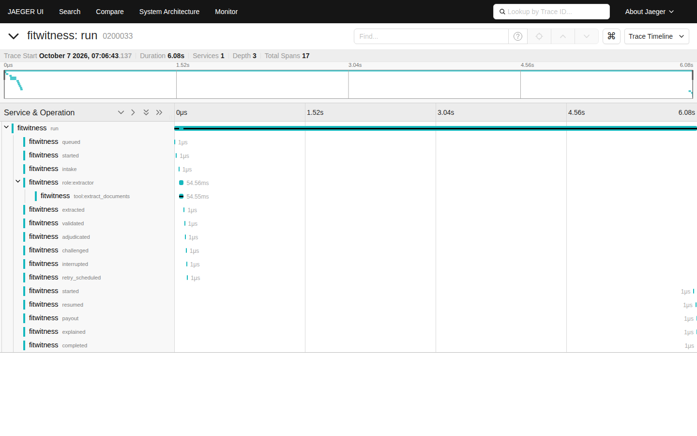

# 관측: 실행 기록에서 나오는 지표와 trace

실행마다 남는 이벤트 로그(`fw_events`)가 유일한 기록원입니다. 지표와 trace는 모두 이 로그에서 계산되므로, 계측 코드를 따로 두지 않고 실행이 죽은 뒤에도 같은 값을 다시 만들 수 있습니다.

| 무엇 | 어디서 | 비고 |
|---|---|---|
| Prometheus 지표 | `GET /metrics` | 실행 상태별 개수, 비용·토큰, 도구 호출, 이벤트 종류별 개수(완료·실패·보류함 포함), 가장 오래 기다린 실행의 대기 시간, 기한 넘긴 확인 요청 수, 모델·도구 지연 히스토그램. DB에서 계산하므로 worker가 여러 프로세스여도 합산됩니다 |
| 알림·기록 규칙과 대시보드 | `deploy/prometheus`, `deploy/grafana` | 아래 "알림 규칙과 SLO" |
| 실행별 span tree | `GET /api/runs/{id}/trace` | 역할(planner/challenger/extractor)별로 묶은 트리 |
| OpenTelemetry (OTLP) | `GET /api/runs/{id}/trace?format=otlp`, worker의 자동 전송, `python -m fitwitness.runtime.otlp` | 아래 |

## OpenTelemetry로 내보내기

환경 변수 하나로 켭니다. 표준 변수 이름을 그대로 씁니다.

```bash
OTEL_EXPORTER_OTLP_ENDPOINT=http://localhost:4318         # <endpoint>/v1/traces 로 전송
OTEL_EXPORTER_OTLP_TRACES_ENDPOINT=https://host/v1/traces  # 전체 URL을 줄 때(위보다 우선)
OTEL_EXPORTER_OTLP_HEADERS=authorization=Bearer xxx        # 인증 헤더
FITWITNESS_ENV=production                                  # deployment.environment (기본 local)
```

설정이 없으면 아무 일도 일어나지 않고, 설정이 있어도 전송은 실패해도 되는 부가 작업입니다(백엔드가 꺼져 있으면 짧은 제한 시간 뒤 로그 한 줄). 로컬에서 보려면 `docker compose -f deploy/observability/docker-compose.yml up -d` 후 `http://localhost:16686`에서 서비스 `fitwitness`를 고릅니다. Tempo나 OpenTelemetry Collector, 상용 백엔드도 같은 방식입니다.

- **한 실행은 한 번 전송됩니다.** 완료·실패·취소·무효화로 끝났을 때만 보냅니다. 담당자 응답을 기다리는 중이거나 재시도 대기 중인 실행은 아직 보내지 않습니다. OTLP에는 "이 span을 갱신"이 없고, 같은 span ID를 두 번 받은 백엔드는 둘 다 보관합니다(Jaeger 메모리 저장소에서 재개된 청구가 루트 2개로 보인 것을 확인하고 이렇게 바꿨습니다). 끝난 뒤의 trace는 대기한 시간까지 포함한 전체를 담습니다.
- **강제 종료된 실행도 보입니다.** 지급 기록 직후 worker가 죽는 체험(`중단 체험`)은 `interrupted → retry_scheduled → (백오프 5초) → started → resumed → payout → completed`가 한 trace에 이어집니다. 아래 화면이 그 예입니다.
- **ID는 결정적입니다.** trace ID는 실행 ID, span ID는 실행 ID와 이벤트 순번에서 만듭니다. 운영자가 `python -m fitwitness.runtime.otlp --tenant T --run R`로 같은 실행을 다시 보내도 같은 span이 됩니다. 아직 끝나지 않은 실행을 보려면 `--include-open`을 붙입니다.
- **span 속성**은 스칼라만 담습니다(`fw.latency_ms`, `fw.items`, `fw.role` 등). 중첩된 payload는 이벤트 로그에만 있습니다. 루트 span에는 실행 종류(drawing/claim)와 상태, 모델·도구 시간 합계가 붙습니다.
- **GenAI 의미 규약의 이름**을 함께 답니다. 역할 span은 `gen_ai.operation.name=invoke_agent`와 `gen_ai.agent.name`(planner/challenger/extractor), 모델 호출 span은 `chat`과 `gen_ai.provider.name`, `gen_ai.request.model`, `gen_ai.usage.input_tokens`, `gen_ai.usage.output_tokens`, 도구 호출 span은 `execute_tool`과 `gen_ai.tool.name`입니다. 모델 호출 span의 kind는 CLIENT(프로세스 밖으로 나가는 호출), 나머지는 INTERNAL입니다. 아래 절에 자세히 적습니다.



## span 이름과 속성: GenAI 의미 규약

OpenTelemetry의 GenAI 의미 규약(semantic conventions)은 에이전트 한 턴, 모델 호출 한 번, 도구 호출 한 번을 어떤 이름으로 부를지 정해 둔 목록입니다. 이 이름을 쓰면 규약을 아는 백엔드(Jaeger·Tempo의 검색, 상용 LLM 관측 도구의 "agent"·"model" 화면)가 fitwitness의 span을 다른 서비스의 것과 같은 방식으로 찾습니다. 이름은 코드에 적지 않고 고정된 `opentelemetry-semantic-conventions` 패키지(0.66b0)의 상수에서 가져오며, 요청의 `resourceSpans`·`scopeSpans`에 그 판의 schema URL(`https://opentelemetry.io/schemas/1.44.0`)을 붙여 백엔드가 어느 판의 이름인지 알게 합니다.

| span | `gen_ai.operation.name` | 그 밖의 `gen_ai.*` | kind |
|---|---|---|---|
| 역할 묶음 `role:planner` 등 | `invoke_agent` | `gen_ai.agent.name` = 역할 이름 | INTERNAL |
| 모델 호출 `model:<model_id>` | `chat` | `gen_ai.provider.name`(anthropic/openai), `gen_ai.request.model`, `gen_ai.usage.input_tokens`, `gen_ai.usage.output_tokens`, `gen_ai.agent.name` = 호출한 역할 | CLIENT |
| 도구 호출 `tool:<name>` | `execute_tool` | `gen_ai.tool.name`, `gen_ai.agent.name` | INTERNAL |
| 그 밖의 이벤트(queued, verified, payout 등) | 없음 | 없음 | INTERNAL |

- 이름이 바뀌어도 기존 대시보드가 깨지지 않도록 `fw.*` 속성(`fw.role`, `fw.model_id`, `fw.usage_input_tokens` 등)은 그대로 둡니다. 같은 값이 두 이름으로 실립니다.
- 토큰 수는 모델 이벤트의 `usage`(provider가 돌려준 값)에서 옵니다. 규칙 provider의 실행에는 모델 호출 span이 없으므로 이 속성도 없습니다.
- GenAI 규약은 아직 incubating(확정 전) 단계라 이름이 바뀔 수 있습니다. 패키지 판을 고정하고 schema URL을 실어 두는 것이 그에 대한 대비이고, 바뀌면 패키지를 올리고 단위 테스트가 잡는 이름을 바꾸면 됩니다.
- 확인한 것은 단위 테스트까지입니다. 공식 protobuf 정의로 파싱되는 요청에 위 이름과 값, schema URL이 실리는지를 테스트가 봅니다. GenAI 규약을 아는 백엔드의 화면에서 실제로 에이전트·모델 호출로 분류되는 것은 보지 못했습니다. 앞서 Jaeger에 보낸 기록은 이 이름을 붙이기 전의 것입니다.

## 확인한 것과 하지 않은 것

- OTLP 요청이 공식 protobuf 정의(`opentelemetry-proto`)로 파싱되는지 단위 테스트가 확인합니다. 이 테스트 덕분에 ID 표기를 바로잡았습니다: OTLP/JSON은 trace·span ID를 base64가 아니라 16진수 문자열로 보냅니다.
- 실제 백엔드로는 **Jaeger 1.76.0 all-in-one 바이너리**를 로컬에서 띄워 청구·도면 실행과 중단 후 복구 실행을 보내고 trace 조회 API로 되읽었습니다. span 수·부모-자식 관계·상태가 맞았고 Jaeger의 경고(음수 지속 시간, 부모 범위 밖의 자식)는 0건이 되도록 고쳤습니다.
- `deploy/observability/docker-compose.yml`은 위와 같은 버전의 Jaeger 이미지를 쓰지만, 이 개발 환경에는 Docker 데몬이 없어 compose 파일 자체는 실행해 보지 못했습니다.
- 공개 데모(Render)는 OTLP 백엔드가 없어 전송을 켜지 않았습니다. Langfuse 같은 LLM 전용 관측 도구는 붙이지 않았습니다. 공개 데모가 규칙 엔진이라 모델 호출 trace가 비어 있고, 모델 호출은 운영자 실행에서만 생기기 때문입니다.
- 알림 규칙과 SLO는 아래 절에 있습니다. 실제로 받은 알림이나 SLO를 지킨 기간의 기록은 없습니다.

## 알림 규칙과 SLO

`deploy/prometheus/rules`에 기록 규칙 14개와 알림 규칙 13개가 있고, `deploy/prometheus/tests`의 promtool 단위 테스트가 알림마다 울려야 할 때와 조용해야 할 때를 합성 시계열로 확인합니다. 대시보드는 `deploy/grafana/dashboards/fitwitness.json`입니다. 로컬에서 함께 띄우는 방법은 `deploy/observability/docker-compose.yml`의 `metrics` 프로필에 적었습니다.

**SLO 하나.** 끝난 실행 가운데 99%가 완료로 끝난다(완료 / (완료 + 실패 + 보류함)). 실패는 재시도하지 않는 오류, 보류함은 일시 오류로 세 번 시도해 실패한 뒤 옆으로 치운 실행입니다. 담당자 확인을 기다리는 실행은 아직 끝나지 않았으므로 세지 않습니다. 99%는 운영 기록에서 정한 값이 아니라 출발점입니다. 실제 모델 경로의 네 번째 측정 18회는 모두 완료로 끝났고, 그 앞의 측정에서는 끝나지 못한 실행이 있었습니다.

| 알림 | 조건 | 등급 | 근거로 삼은 측정값 |
|---|---|---|---|
| `FitwitnessDown` | `/metrics`가 2분 동안 응답 없음 | page | 무료 인스턴스가 잠들어도 같은 모양 |
| `FitwitnessDatabaseMetricsMissing` | 앱은 답하는데 DB에서 계산하는 지표가 5분 동안 없음 | page | `/ready`가 503이면 DB |
| `FitwitnessQueueStalled` | worker가 가져갔어야 할 실행이 300초 넘게 기다림, 5분 지속 | page | 큐 등록에서 worker 시작까지 로컬 0.16초, 공개 서버 0.03~0.06초 |
| `FitwitnessReviewsNotEscalated` | 기한 넘긴 확인 요청이 10분 동안 상급 검토로 옮겨지지 않음 | ticket | 옮기는 일은 dispatcher가 돌 때마다 함 |
| `FitwitnessDeadLetter` | 15분 안에 보류함에 간 실행이 있음 | ticket | |
| `FitwitnessRunFailureFastBurn` | 1시간 동안 끝난 실행의 14.4% 넘게 실패, 10건 이상, 5분 지속 | page | SLO 99%의 14.4배 |
| `FitwitnessRunFailureSlowBurn` | 6시간 동안 6% 넘게 실패, 20건 이상, 30분 지속 | ticket | SLO 99%의 6배 |
| `FitwitnessModelErrors` | 15분 안에 모델 오류와 스키마 실패가 3건 이상, 5분 지속 | ticket | 키·잔액·모델 ID 문제는 첫 호출부터 거부됨 |
| `FitwitnessBudgetStopsHigh` | 1시간 동안 끝난 실행의 20% 넘게 예산으로 멈춤, 10건 이상, 15분 지속 | ticket | |
| `FitwitnessSpendHigh` | 1시간 모델 비용이 0.5달러 초과 | ticket | 실행 한 번 0.0043~0.0097달러([COST.md](COST.md)), 50~100회에 해당. 공개 데모는 유료 호출을 거부하므로 0이어야 함 |
| `FitwitnessModelLatencyHigh` | 역할별 모델 호출 p95가 10초 초과, 15분 지속 | ticket | 모델 호출 한 번의 중앙값 0.7~2.4초, p95 0.9~1.9초([COST.md](COST.md)) |
| `FitwitnessApiSlow` | API 요청 p95가 2.5초 초과, 초당 0.05건 이상, 10분 지속 | ticket | 공개 서버에서 체험 공간 생성 1.1초, 실행 0.34~0.54초([WORKFLOW.md](WORKFLOW.md)) |
| `FitwitnessApi5xx` | 5xx가 5% 초과, 초당 0.05건 이상, 5분 지속 | page | |

비율 알림에는 모두 최소 건수를 붙였습니다. 트래픽이 거의 없어서 한 시간에 실행 하나가 실패하면 비율은 100%가 되기 때문입니다. 빠른·느린 소진 알림은 흔히 쓰는 다중 창 방식에서 긴 창만 쓴 것입니다. 이 트래픽에서는 5분 창이 대개 비어 있어서입니다.

**만들면서 고친 것 두 가지.**

- 지표의 counter는 이벤트·실행 테이블에서 긁을 때마다 계산하는데, 체험 공간이 만료되면 그 행이 지워져 counter가 줄어들었습니다. Prometheus는 줄어든 counter를 재시작으로 읽고 남은 값 전체를 새 증가로 셉니다. 공간 하나가 만료될 때마다 보류함 알림이 거짓으로 울릴 수 있었습니다. 지금은 만료 정리가 행을 지우기 전에 그 수를 `fw_metric_totals`에 더하고, counter는 남은 행과 그 합계를 더한 값입니다. 통합 테스트가 만료 전후의 counter가 같음을 확인하고, 더하는 두 줄을 빼면 이 테스트가 실패하는 것을 보았습니다. 지연 히스토그램은 옮기지 않아서 남아 있는 공간만 담습니다.
- 처리하지 못한 예외로 난 500은 요청을 세는 미들웨어 바깥에서 만들어져 `fitwitness_requests_total`에 잡히지 않았습니다. 5xx 알림이 가장 중요한 경우를 못 보는 셈이라, 미들웨어가 예외를 500으로 세고 다시 던지게 했습니다. 이것도 통합 테스트가 있고, 고치기 전 코드에서는 실패합니다.

**확인한 것.**

- `promtool check rules`와 `promtool test rules`(Prometheus 3.5.0): 시험 묶음 14개, 알림 검사 26개(알림 13개 모두 울리는 경우와 조용한 경우), 기록 규칙 값 검사 2개가 통과합니다. 문턱값 다섯 군데를 바꿔 보면(대기 300 → 500초, 최소 건수 10 → 5건, 느린 소진 6배 → 14.4배, 모델 오류 3 → 2건, API 최소 요청률 제거) 각각 테스트가 실패합니다. CI의 `prometheus-rules` 작업이 sha256을 고정한 promtool로 매 커밋 이것과 설정 파일 검사를 돌립니다.
- 실제 Prometheus 3.5.0 바이너리가 로컬 앱(uvicorn, 로컬 PostgreSQL)을 5초마다 긁게 하고 규칙 27개를 평가했습니다. 대상은 `up`, 규칙은 모두 `ok`, 대시보드의 식 23개는 모두 오류 없이 돌았습니다. 디스패치 행이 사라진 실행을 하나 넣었더니(10분 전에 큐에 들어간 것으로) `FitwitnessQueueStalled`가 바로 pending이 되고 5분 뒤 firing이 됐습니다. 같은 DB로 통합 테스트를 돌리는 동안 재시도를 다 쓴 테스트 실행이 실제로 보류함에 가서 `FitwitnessDeadLetter`도 울렸습니다. 기록은 [verification/prometheus-local-20261025.json](verification/prometheus-local-20261025.json)에 있습니다.

**하지 않은 것.**

- 실제로 받은 알림은 없습니다. Alertmanager와 받는 곳(메일·Slack·당번)을 설정하지 않았고, 울린 알림은 Prometheus의 `/alerts` 화면과 대시보드의 표에만 보입니다.
- 공개 데모(Render 무료)는 아무도 긁지 않습니다. 실제 트래픽에서 문턱값이 맞는지, 거짓 경보가 얼마나 나는지는 모릅니다.
- Grafana는 이 환경에서 받을 수 없어(dl.grafana.com 차단) 대시보드를 띄워 보지 못했습니다. JSON 형식과 각 패널의 식이 실제 Prometheus에서 도는 것까지만 확인했습니다. `docker compose --profile metrics`도 Docker 데몬이 없어 실행하지 못했습니다.

